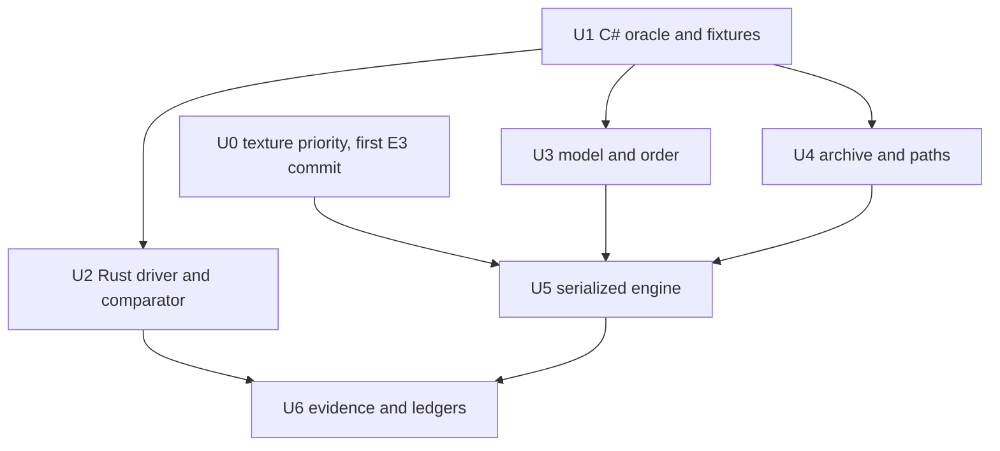

# Engine actions and archives parity plan

Plan date: 2026-09-27. Target Rust baseline: `cf64f539776e730fd16ae25a5d83402ccdf7cfa0`. Pinned C# oracle: `d31ccbd3bfcddb4705917eafa6483715c166de3b`. Audit authority: `docs/parity/engine-actions-archives-audit.md:1-154`. This plan advances F04-F07 and cannot close F09, F10, F24, F26, F28, or F29 by itself (`docs/parity/ACCEPTANCE.md:39-64`).

## Goal capsule

- **Objective:** A disposable fixture run through pinned C# and production Rust produces an explained, reviewed outcome for every F04-F07 case: equal behavior where compatibility is required, or an explicit fail-closed divergence where repository safety rules prohibit copying C# behavior (`docs/parity/ACCEPTANCE.md:39-42`; `AGENTS.md:7-10`).
- **Means:** Establish a versioned differential corpus and manifest comparator first, then correct shared model/path/archive/engine behavior in serialized ownership lanes, using production CLI/native probes and the prebuilt C# assemblies rather than Rust tests or Rust harnesses (`docs/parity/validation-reference/receipt.json:13-18`; `docs/parity/install-progress-plan.md:5-14`).
- **Authority order:** Current user constraints and `AGENTS.md` safety rules; F04-F07 acceptance rows; pinned C# source/runtime; deliberate documented Rust safety deviations; current Rust behavior (`AGENTS.md:7-10`; `docs/parity/ACCEPTANCE.md:28-42`).
- **Stop conditions:** Stop before live game/mod paths, external untrusted programs, unsafe archive publication, a dirty C# oracle, an unbound binary, missing prebuilt assemblies, an occupied `src/engine.rs` or `src/ui.rs` lane, or a retry over a failed fixture without restoring its verified baseline (`AGENTS.md:7-10`; `docs/parity/validation-reference/receipt.json:3-18`).
- **Acceptance owner:** The final integration owner reconciles every case ID in `docs/parity/engine-actions-archives-audit.md`, runs both production implementations on restored disposable fixtures, obtains review gates, updates the ledgers, and makes the only domain-completion recommendation. Individual source owners cannot close F04-F07 from local success.

## Binding constraints

1. Do not create, modify, port, compile, or run Rust tests, inline test modules, integration tests, examples used as harnesses, or temporary Rust harnesses. Existing Rust test code remains byte-for-byte unchanged. The repository's four ordinary Cargo checks remain documented project gates (`AGENTS.md:6`), but this slice does not run test or all-target gates while the user's parity freeze is active.
2. Use production library/CLI/native entry points only. A Rust probe means invoking the production `modsync` executable against disposable guides and roots, never importing `Engine` from probe code. The existing house plan makes the same direct-probe distinction (`docs/parity/install-progress-plan.md:7-14`).
3. C# source stays clean at the pinned commit. C# observation may use a small disposable .NET probe project that references the already-built `ModSync.Core.dll`, or the prebuilt CLI/native application when it exposes the needed path. It must not modify C# product source or rebuild the oracle (`docs/parity/validation-reference/README.md:3-8`, `docs/parity/validation-reference/receipt.json:13-18`).
4. Every install root, archive root, scratch directory, settings directory, process stub, and output directory is newly created under one owned temporary fixture root. No probe uses a user game, mod tree, baseline, cache, profile, settings directory, or desktop session (`AGENTS.md:7`).
5. Validation remains read-only and never launches external programs. Installation preserves guide order and stops on the first failed instruction. Before every retry, restore and hash-verify the complete fixture baseline; do not append a repaired earlier instruction after later steps (`AGENTS.md:8-9`).
6. `src/engine.rs` is a serialized file with the fixed E0-E4 order below. No F04-F07 worker starts an engine edit until E2 releases it and the integration owner records the new base SHA. `src/ui.rs` is reserved in this order: install-progress, completion-pages, then mod-selection. This plan schedules no `src/ui.rs` edit; F04 presentation gaps remain with the mod-selection lane.
7. `src/archive.rs` and `src/paths.rs` have one owner together because archive entry validation calls the shared relative-path rules (`src/archive.rs:1-2`, `src/archive.rs:35-57`). `src/model.rs` has one owner. `src/engine.rs` has one owner. Evidence/docs have one owner after source owners finish. No worker edits outside its declared file set.
8. Do not weaken Rust safety to copy a C# defect. In particular, retain fail-closed unsafe-entry handling, symlink/special-file rejection, root containment, recovery preflight, and the ban on executing SFX payloads (`src/paths.rs:13-39`, `src/paths.rs:92-119`, `src/archive.rs:47-57`, `src/archive.rs:274-276`). Record the observed divergence in compatibility docs.
9. Update `COMPATIBILITY.md` whenever behavior or a proof boundary changes, and update `docs/parity/ACCEPTANCE.md`, `docs/parity/GUI-CLI.md`, and `docs/parity/GUI-INVENTORY.md` only from measured receipts (`AGENTS.md:11`; `docs/parity/ACCEPTANCE.md:28-32`).
10. Do not publish a release or open an upstream PR. Local commits and a proposed PR body are allowed; external publication requires a later explicit user request (`AGENTS.md:12`).
11. `AGENTS.md` line numbers refer to the committed 12-line file (`git show HEAD:AGENTS.md`), not to a modified working copy.
12. C# runs use the durable reference copy at `/home/brunner56/.cache/modsync-csharp-ref/d31ccbd3/`, made and hashed as the prerequisite in `docs/parity/patcher-plan.md`. The `/tmp` build path is tmpfs and is not used.

## Requirements

### Differential authority

- R1. Every audit case ID F04-A through F07-F has a fixture definition, C# command, Rust command, expected observable schema, and final verdict in the evidence index (`docs/parity/engine-actions-archives-audit.md:33-122`).
- R2. Every run binds C# commit/assembly hashes, Rust commit/binary hash, fixture-generator hash, guide/archive hashes, environment capabilities, command lines, exits, stdout/stderr hashes, elapsed time, peak RSS when applicable, and pre/post manifests (`docs/parity/validation-reference/receipt.json:2-18`, `docs/parity/validation-reference/receipt.json:81-111`).
- R3. A comparison verdict is based on semantic normalized output and raw retained artifacts; normalization may remove absolute temporary roots and timestamps only, never order, case, missing files, messages, exits, or bytes (`docs/parity/ACCEPTANCE.md:28-32`).

### F04 model and ordering

- R4. Component and option defaults, selection reachability, game fields, dependency/restriction conditions, and ordered GUIDs match pinned C# where doing so does not violate a binding Rust safety rule (`docs/parity/ACCEPTANCE.md:39`).
- R5. Component `Dependencies`, `InstallBefore`, and `InstallAfter` have one explicitly measured execution-order contract; missing/cyclic/conflicting references fail with stable diagnostics and never reorder a retry after mutation (`src/model.rs:319-390`; pinned C# `src/ModSync.Core/Services/DependencyResolverService.cs:167-270`).
- R6. Choose executes only reached selected options, in declared order, and nested failure stops all later option/component work (`src/engine.rs:1098-1139`, `src/engine.rs:1331-1350`; pinned C# `src/ModSync.Core/ModComponent.cs:1648-1667`).

### F05 actions and paths

- R7. The production Rust engine has an explicit compatible or deliberate-divergence verdict for all twelve action labels and cross-action cases F05-X1 through F05-X6 (`src/model.rs:404-426`; `docs/parity/engine-actions-archives-audit.md:46-74`).
- R8. Copy, Move, Rename, Delete, Extract, DelDuplicate, and CleanList compare exact final paths and SHA-256 bytes (`src/engine.rs:1315-1546`). Process actions (`Execute`, `Run`, `Patcher`) live in `process()`, which `docs/parity/patcher-plan.md` Phase 1 (E1) owns. Their argv, working directory, output, exit, cancellation and later-step comparisons come from that plan's P02, P03, P05 and P06 receipts. Any cancellation probe here runs through the production desktop app (Stop install, `src/ui.rs:3149`), because CLI `install` never sets `settings.cancelled` (`src/main.rs:1061-1071`).
- R9. Placeholder, wildcard, case, overwrite, missing-source, and prior-produced-source behavior is decided at shared library boundaries in `src/paths.rs`, `src/model.rs`, `src/archive.rs`, and `src/engine.rs`, never independently in CLI or desktop presentation (`src/paths.rs:61-89`, `src/engine.rs:1154-1222`).

### F06 archives

- R10. ZIP, 7z, RAR, TAR, GZip, and 7z SFX compare default/explicit layout, bytes, corruption, unsafe entries, cancellation, large content, and cleanup using the F06 case IDs (`docs/parity/engine-actions-archives-audit.md:76-92`).
- R11. Rust continues to decode archive input without executing it and fails closed before publishing an unsafe or corrupt archive, even where pinned C# skips an entry or executes a Windows SFX fallback (`src/archive.rs:274-276`; pinned C# `src/ModSync.Core/Services/FileSystem/RealFileSystemProvider.cs:181-196`).
- R12. Large-file acceptance records >512 MiB final hashes, peak RSS, elapsed time, scratch high-water/free-space behavior, and cleanup for both compressible and incompressible data; a Rust-only 513 MiB historical run is insufficient (`COMPATIBILITY.md:130`, `COMPATIBILITY.md:155-157`). Both implementations run with `TMPDIR`, scratch and destination on disk-backed storage, for example `/home/brunner56/.cache/modsync-f06-large/<run-id>/{tmp,scratch,root}` on the NVMe home disk. `/tmp` is tmpfs here, so it would measure RAM, not disk scratch, and the C# SFX path copies its tail to system temp (`src/ModSync.Core/Utility/ArchiveHelper.cs:221-230`). Check free space before each run and stop if the run could fill the disk.
- R13. Nested archives are extracted only by authored sequential Extract instructions; neither runtime silently recursively expands an inner archive (`src/engine.rs:950-1053`, pinned C# `src/ModSync.Core/Services/FileSystem/RealFileSystemProvider.cs:137-270`).

### F07 cleanup

- R14. CleanList decisions and final deleted-file sets match for mandatory, exact, substring, token-threshold, malformed-row, encoding, multi-source, missing-target, and unsafe-target fixtures (`src/engine.rs:1521-1542`, `src/engine.rs:1735-1775`).
- R15. DelDuplicate defaults to the C# texture-priority list `.dds`, `.tpc`, `.tga`, in that order, and produces the same survivors as pinned C# for every priority extension, explicit extension list, case variant, and two/three-way collision (`src/engine.rs:1485-1520`; pinned C# `src/ModSync.Core/Data/Game.cs:11`, `src/ModSync.Core/Instruction.cs:586-668`).

## Key technical decisions

- KTD1. **Case-ID corpus is the unit of proof.** Each fixture directory is named by the audit ID and produces one machine-readable result per implementation plus one comparison. This prevents a passing aggregate from hiding an unexecuted row (R1-R3; `docs/parity/engine-actions-archives-audit.md:113-122`).
- KTD2. **C# is observed through prebuilt product assemblies.** Prefer the prebuilt CLI/native surface; where no product command exposes a library-only observable, compile only a disposable C# console probe against the hashed existing assemblies. Do not rebuild or patch the oracle (R2; `docs/parity/validation-reference/receipt.json:13-18`, `docs/parity/validation-reference/README.md:72-76`).
- KTD3. **Rust is observed only through production surfaces.** Build the normal production binary on the host and invoke its CLI/native commands. Do not add a Rust oracle, example, benchmark, test, or `rustc` scratch program (R1-R15; `docs/parity/install-progress-plan.md:7-14`).
- KTD4. **Comparison is semantic plus byte-exact.** Compare parsed ordered events/reports after narrow path/time normalization, but compare guide inputs, archives, and final regular-file bytes by SHA-256 without normalization (R2-R3, R8, R10; `docs/parity/validation-reference/receipt.json:32-37`, `docs/parity/validation-reference/receipt.json:81-109`).
- KTD5. **Safety wins over defect compatibility.** C# skip-and-continue for unsafe entries and Windows SFX execution are recorded divergences; Rust retains reject-before-publish and never-execute behavior (R11; `AGENTS.md:10`, `src/archive.rs:274-276`).
- KTD6. **Engine semantics have one owner.** Model/path/archive changes land before the sole engine owner rebases and implements action coordination. CLI and UI format typed results but do not acquire action, ordering, or archive policy (R4-R15; `AGENTS.md:5`, `docs/parity/GUI-INVENTORY.md:116`).
- KTD7. **No test freeze workaround.** Direct probes produce durable evidence under `docs/parity/engine-actions-archives-evidence/`; the freeze is not bypassed by placing Rust code outside `tests/` or calling it a tool (R1-R15; `docs/parity/ACCEPTANCE.md:20-28`).

## Shared library versus presentation boundary

Shared library owners decide and expose:

- parsed component/option/default/game-field state and stable ordered GUIDs (`src/model.rs:34-84`, `src/model.rs:303-390`);
- placeholder containment, wildcard/case matching, and actual-path resolution (`src/paths.rs:13-119`, `src/engine.rs:1154-1249`);
- archive detection, streaming, scratch budgets, entry safety, cancellation, and decoded entries (`src/archive.rs:14-113`, `src/archive.rs:114-356`);
- action applicability, Choose reachability, overwrite/missing-source results, mutations, process outcome, and stop boundary (`src/engine.rs:997-1139`, `src/engine.rs:1154-1697`).

Presentation/adapter owners may only:

- serialize existing typed facts and actual errors;
- show C# versus Rust result rows, paths relative to the fixture root, manifests, metrics, and deliberate-divergence labels;
- select a fixture/phase and request the shared operation.

They may not recompute selection, ordering, glob matches, compatible extensions, extraction layout, success, or severity. This follows the existing GUI/CLI boundary that shared calls alone are insufficient and presentation must not own orchestration predicates (`docs/parity/GUI-INVENTORY.md:116`, `docs/parity/GUI-CLI.md:5-17`).

## Differential probe contract

### Fixture layout

Create `docs/parity/engine-actions-archives-evidence/` only during execution, with this durable shape:

```text
engine-actions-archives-evidence/
  README.md
  receipt.json
  cases.json
  oracle/
    Program.cs
    probe.csproj
  fixtures/<case-id>/
    guide.json
    inputs/
    expected-policy.json
  results/<case-id>/
    csharp.json
    rust.json
    comparison.json
    csharp.stdout
    csharp.stderr
    rust.stdout
    rust.stderr
    csharp-tree-before.json
    csharp-tree-after.json
    rust-tree-before.json
    rust-tree-after.json
```

The C# probe project is permitted because it contains no product-source change and references prebuilt DLLs (KTD2). The Rust side has no analogous source directory (KTD3).

### Common observable schema

Each implementation result records:

- `caseId`, `implementation`, source commit, binary hashes, fixture hashes, platform, filesystem, locale, case-sensitivity capability, and tool availability;
- exact command/arguments, normalized owned root mapping, start/end UTC, monotonic elapsed, exit code, timeout/cancel result, stdout/stderr SHA-256 and retained raw paths;
- loaded selected GUIDs, reached component/option GUID order, reached instruction action order, and final structured report/event sequence when exposed;
- before/after manifests for game, mod, scratch, settings, recovery state, and owned system-temp sentinel directory;
- for every regular file: relative path, length, mode where available, mtime where relevant, and SHA-256;
- process-probe argv, working directory, environment allowlist, stdout/stderr, and exit when an external action is intentionally exercised;
- peak RSS and scratch high-water/free-space snapshots for F06-LARGE.

The comparator removes only owned absolute-root prefixes, run IDs, PIDs, and wall-clock timestamps. It preserves list order, case, messages, issue categories/severity, exit codes, modes, sizes, hashes, and missing/present distinctions (KTD4).

### Isolation and restore protocol

1. Verify the C# source commit and clean status, then hash the prebuilt runtime host and assemblies against `docs/parity/validation-reference/receipt.json:3-18`.
2. Generate immutable fixture inputs once, hash them, and copy them into separate C# and Rust run roots. Never share mutable roots between implementations.
3. Record complete before manifests. Reject symlinks, roots under a game/mod tree, overlapping roots, insufficient space, or an unavailable scratch path before launch (`src/paths.rs:42-58`).
4. Run C# once and Rust once. Do not retry in place. On timeout or failure, retain the run root and restore a fresh verified copy for the next attempt.
5. Record after manifests and process metrics before cleanup. Compare raw outcomes, then assign `equal`, `compatible-normalized`, `deliberate-safer-divergence`, or `mismatch-needs-code`.
6. A `deliberate-safer-divergence` requires a named binding rule and reviewer approval; it is not a generic escape hatch (KTD5).

## Implementation units and serialized ownership

### `src/engine.rs` serialized order

`src/engine.rs` has one writer at a time. This order is shared with `docs/parity/patcher-plan.md` and is binding for both plans:

- **E0: install-progress Task 1.** Already landed; `origin/main` is at `cf64f53`.
- **E1: patcher Phase 1.** Owns `process()` (about `src/engine.rs:1549-1733`), including `Execute`/`Run` placeholder expansion and ordered multi-source execution.
- **E2: deployment staging hook.** Adds `Settings.managed`, the `put`/`delete`/`actual` redirects (about `src/engine.rs:1238-1313`) and the barrier around `process()`.
- **E3: engine U5.** One action group per commit. Each commit is probed in classic and managed modes.
- **E4: patcher Phase 6.** Writes `src/deployment.rs` and `src/recovery.rs` only; no `src/engine.rs` write.

A phase starts only after the previous owner releases the file and the integration owner records the new base SHA. U0 below is the first commit of E3.

### U0. Texture priority default (first task, highest priority)

- **Goal:** Make the DelDuplicate default match C# now.
- **Requirements:** R15.
- **Dependencies:** None on U1-U4. It is the first commit of E3.
- **Owned files:** `src/engine.rs`, the DelDuplicate default only.
- **Approach:** Replace the two-entry default `.tga`, `.tpc` (`src/engine.rs:1488`) with `.dds`, `.tpc`, `.tga`, in that order. The C# list is `Game.TextureOverridePriorityList` (`src/ModSync.Core/Data/Game.cs:11`), used as the fallback at `src/ModSync.Core/Instruction.cs:588`. Open question 6 is resolved by these two lines; no observation is needed before the change.
- **Direct probe scenarios:** F07-E only confirms the change: every same-stem group of the three extensions, mixed case, and unrelated extensions, in classic and managed modes.
- **Verification:** F07-E survivor sets equal C#.

### U1. Differential corpus and prebuilt C# oracle adapter

- **Goal:** Materialize every audit case as deterministic disposable input and make pinned C# emit the common observable schema.
- **Requirements:** R1-R3.
- **Dependencies:** None.
- **Owned files:** `docs/parity/engine-actions-archives-evidence/oracle/Program.cs`, `docs/parity/engine-actions-archives-evidence/oracle/probe.csproj`, `docs/parity/engine-actions-archives-evidence/cases.json`, `docs/parity/engine-actions-archives-evidence/fixtures/`, evidence helper scripts only if they contain no Rust code.
- **Approach:** Reference the hashed `ModSync.Core.dll`; expose load, selection/order, validation, and one-action install observables; wrap file/process providers only where the product CLI cannot expose the result. Keep each case independent and retain raw output.
- **Execution note:** Start with source-expected C# observations only. Do not read Rust results while defining expected C# outcomes; this preserves the independent-first comparison rule.
- **Direct probe scenarios:** F04-A through F04-H; every C# column for F05/F06/F07; assembly-hash mismatch; missing runtime dependency; timeout; C# partial-write corruption case.
- **Verification:** The adapter runs against the receipt-bound assemblies without changing the C# worktree, and every case produces a complete `csharp.json` plus manifests or a typed environment-blocked result.

### U2. Rust production probe driver and semantic comparator

- **Goal:** Invoke only the production Rust executable for every case and compare it with U1 without embedding engine logic.
- **Requirements:** R1-R3, R7-R15.
- **Dependencies:** U1 fixture/schema contract.
- **Owned files:** non-Rust scripts under `docs/parity/engine-actions-archives-evidence/`, `docs/parity/engine-actions-archives-evidence/README.md`, generated `results/` and `receipt.json`.
- **Approach:** Build the ordinary production binary on the host into an owned target directory only after source work is ready; drive `list`, `validate`, `conflicts`, and `install` as applicable; collect manifests and normalize only the KTD4 fields.
- **Execution note:** This unit never writes `.rs`, never invokes `cargo test`, and never imports the Rust crate. Re-run after U3-U5 from fresh fixture copies.
- **Direct probe scenarios:** Production binary hash mismatch; nonzero install; malformed stdout; missing receipt field; deliberate safe divergence; unexpected file, order, case, message, exit, or hash difference.
- **Verification:** Every case has raw C#/Rust artifacts and a comparison verdict; the comparator fails if either side is absent or any unapproved field is normalized.

### U3. Component/option/default/order parity

- **Goal:** Resolve F04-A through F04-H in shared model/selection/order code without entering the serialized engine or UI lanes.
- **Requirements:** R4-R6.
- **Dependencies:** U1 baseline observations.
- **Owned files:** `src/model.rs`; `src/game.rs` or `src/selection.rs` only after confirming the gap belongs there and reserving that file; no `src/ui.rs`; no test files or inline test edits.
- **Approach:** Separate loader defaults from CLI/GUI selection policy; represent game fields explicitly if metadata defaults cannot match; reconcile Dependencies versus ordering from measured F04-D/F04-F; preserve stable guide order and fail closed for missing/cyclic references.
- **Patterns:** Existing selected-ID recursion and stable topological loop (`src/model.rs:303-390`); existing game selectability boundary (`COMPATIBILITY.md:124`).
- **Direct probe scenarios:** Every F04 case before and after the change through U2; exact ordered GUID sequence; all-false loader versus CLI policy; nested Choose remains engine-observed but its model inputs originate here.
- **Verification:** F04 comparisons are equal or explicitly reviewed safe divergences, `src/ui.rs` is untouched, and U3 source review finds no frontend policy embedded in the model.

### U4. Archive/path decoding parity and safety

- **Goal:** Resolve format/layout/large/corrupt/metadata gaps at the archive and safe-path boundary before engine integration.
- **Requirements:** R10-R13.
- **Dependencies:** U1 format observations; may run in parallel with U3 because file ownership is disjoint.
- **Owned files:** `src/archive.rs`, `src/paths.rs`; no engine, UI, tests, or evidence comparator files.
- **Approach:** Correct decoder/layout metadata only from measured cases; retain fail-closed traversal/link/collision behavior and never-execute SFX rule; make cancellation and scratch cleanup observable through existing production behavior rather than adding a test-only API.
- **Patterns:** Streaming `Output` budget/cancellation checks (`src/archive.rs:35-99`), signature routing (`src/archive.rs:147-278`), and root/symlink checks (`src/paths.rs:92-119`).
- **Direct probe scenarios:** F06-ZIP/7Z/RAR/TAR/GZ/SFX/DETECT/SAFE/LARGE/CORRUPT/META at the production CLI boundary after U5 connects any required engine behavior.
- **Verification:** No unsafe member reaches an install tree; >512 MiB cases stay within the accepted measured resource envelope; failure leaves no published partial Rust tree; every supported format has a bound C# comparison result.

### U5. Serialized engine action parity

- **Goal:** Resolve the non-process F05 actions, F05-X, nested Choose/archive sequencing, CleanList, and DelDuplicate gaps in the one shared installer. `Execute`, `Run` and `Patcher` (placeholders, multi-source, argv, logs, cancellation) are out of scope; `docs/parity/patcher-plan.md` Phase 1 owns them.
- **Requirements:** R5-R15.
- **Dependencies:** U0, U1, U3, U4. U5 is E3: it starts after E1 (patcher `process()`) and E2 (deployment staging hook) release `src/engine.rs` and the new base SHA is recorded.
- **Owned files:** `src/engine.rs` except `process()` (about `src/engine.rs:1549-1733`), which E1 owns. `src/model.rs`, `src/archive.rs`, `src/paths.rs`, `src/ui.rs`, and test code are read-only in this unit.
- **Approach:** Reconcile one action at a time against its case ID; keep conditions and stop-on-failure common; do not introduce action-specific copies of wildcard, archive, or ordering policy; add typed internal distinctions only where presentation currently parses error prose.
- **Patterns:** Shared action dispatch (`src/engine.rs:1315-1546`) and guide-order execution (`src/engine.rs:950-1053`). The process path is read-only here.
- **Execution note:** Land one action group per commit on the serialized lane. Probe every commit in classic mode and in managed mode (E2's `Settings.managed`). Restore fixtures between every probe; never batch-fix an earlier action by running it after a later one.
- **Direct probe scenarios:** The nine non-process action rows (`Unset`, `Extract`, `Move`, `Copy`, `Rename`, `Delete`, `DelDuplicate`, `Choose`, `CleanList`), F05-X1 through X6, F06-LAYOUT/NEST/CORRUPT, and F07-A through F07-F through U2. F05-EXECUTE, F05-RUN and F05-PATCHER verdicts are taken from patcher-plan receipts.
- **Verification:** Every non-process action produces the accepted exit/order/tree behavior in both modes; no later step runs after an unaccepted failure; Copy/Move/Rename/Delete/Extract/CleanList/DelDuplicate final trees and bytes are compared to C#.

### U6. Independent review gates and ledger integration

- **Goal:** Review source and evidence as separate claims, then update compatibility boundaries without overstating F04-F07 or F29.
- **Requirements:** R1-R15.
- **Dependencies:** U2-U5 complete and rerun from final source SHA.
- **Owned files:** `docs/parity/engine-actions-archives-evidence/`, `docs/parity/ACCEPTANCE.md`, `docs/parity/GUI-CLI.md`, `docs/parity/GUI-INVENTORY.md`, `COMPATIBILITY.md`; source files are read-only.
- **Approach:** Run correctness/maintainability/project-standards review on U3-U5; run a separate adversarial evidence review for missing cases, normalization leakage, unsafe partial writes, stale binaries, and false parity; fix findings only through the original serialized owner.
- **Direct probe scenarios:** Final full case matrix from clean disposable copies; repeat at least deterministic order/case/corruption/large representatives; audit that every comparison cites raw artifacts and both binary hashes.
- **Verification:** Review findings are resolved or explicitly blocking; ledgers name exact proven scope and remaining gaps; no F29/full-build/native-GUI/release claim is inferred.

## Execution order and file ownership



| Stage | Exclusive owner | Files | May overlap |
|---|---|---|---|
| 1 | Oracle/corpus owner | Evidence oracle, fixtures, schema | Independent of source lanes; may run while UI lanes continue because it never edits `src/ui.rs` or `src/engine.rs`. |
| 2A | Model owner | `src/model.rs`; approved `src/game.rs`/`src/selection.rs` expansion only | May overlap 2B after both start from the same recorded base and share no files. |
| 2B | Archive owner | `src/archive.rs`, `src/paths.rs` | May overlap 2A; cannot edit engine or evidence comparator. |
| 3 | Engine owner (E3) | `src/engine.rs` except `process()` | Starts only after 2A/2B and after E1 and E2 release the file. U0 is its first commit. No overlap with any other engine owner. |
| 4 | Probe/evidence owner | Production runs and evidence tree | Starts final run only after Stage 3; no source edits. |
| 5 | Documentation owner | Four parity ledgers and evidence README/receipt | Starts after final receipts and reviews; no source edits. |

`src/ui.rs` remains reserved for install-progress, then completion-pages, then mod-selection. This plan neither queues behind that lane for backend work nor edits around it. Any newly discovered UI-only F04 gap is handed to `docs/parity/mod-selection-plan.md`, not folded into U3/U5.

## Direct differential matrix

| Probe batch | Cases | C# surface | Rust surface | Pass signal |
|---|---|---|---|---|
| Model/defaults | F04-A, F04-G, F04-H | Prebuilt core adapter load result | Production `list`/phase preparation output already exposed by the CLI. This plan adds no CLI command. A value the CLI does not expose is recorded `environment-blocked: no production observable`. | Same typed values/selected IDs or reviewed documented divergence. |
| Selection/conditions/order | F04-B-F, F05-CHOOSE, F05-X5/X6 | Core adapter execution/ordered result | Production `validate`/`install` and typed progress/events | Same reached GUID/action order, exit, report, and no late writes. |
| Pure file actions | F05-COPY/MOVE/RENAME/DELETE, F05-X1-X4 | Core adapter with RealFileSystemProvider | Production `install` | Same relative final tree and SHA-256 bytes; accepted message differences named. |
| External actions | F05-EXECUTE/RUN/PATCHER | Owned by `docs/parity/patcher-plan.md` (P02, P03, P05, P06) | Same | This plan consumes those receipts and runs no process probe of its own. Validation itself launches nothing. |
| Extraction formats | F05-EXTRACT; F06-ZIP/7Z/RAR/TAR/GZ | Prebuilt core RealFileSystemProvider | Production `install`; the cancellation cases of F06-ZIP/7Z/RAR run in the production desktop app (Stop install, `src/ui.rs:3149`) | Same accepted layout/bytes and measured resource record; Rust safety differences explicit. CLI `install` has no cancel wiring (`src/main.rs:1061-1071`), so a CLI cancellation variant waits for a `src/main.rs` cancel hook with its own owner; download-orchestration Task 2a adds Ctrl+C but leaves existing commands unchanged (`docs/parity/download-orchestration-plan.md:332`, `:364`). |
| SFX and detection | F06-SFX/DETECT | Prebuilt core on Linux first; Windows observation only in an owned runner if available | Production `install` without execution | Embedded payload bytes/layout compare; arbitrary executable never runs in Rust. |
| Nested/corrupt/safety | F06-NEST/SAFE/CORRUPT | Core adapter | Production `validate` then `install` | Authored nested sequence works; corrupt/unsafe Rust fails before publication; C# partial behavior captured. |
| Large/scratch | F06-LARGE | Core adapter with `TMPDIR` and destination on disk-backed storage | Production `install --scratch-dir ... --max-expanded-bytes ...` with `TMPDIR` and `--scratch-dir` on disk-backed storage | >512 MiB hashes plus peak RSS/scratch/free-space/cleanup; no OOM or uncontrolled root writes. `/tmp` is tmpfs on this host and is not used by either side. |
| CleanList/texture | F05-CLEAN/DEDUP; F07-A-F | Core adapter | Production `install` | Same final deleted/surviving set except reviewed safe path rejection. |

## Review gates

### Gate A: source correctness

Review U3-U5 against the exact C# lines and case IDs. Reject:

- model defaults inferred from serializers without executable observation;
- component dependency ordering changed without F04-D/F04-F receipts;
- per-action wildcard/case/path reimplementations;
- permissive unsafe-entry or SFX-execution changes;
- swallowed I/O/permission/corruption errors;
- continuation after a failed instruction;
- changes to frozen Rust tests or `src/ui.rs`.

### Gate B: differential evidence integrity

Review U1/U2/U6 independently from source review. Reject:

- C# or Rust binary hash not bound to the receipt/source commit;
- shared mutable roots between implementations or retries;
- missing before/after root, scratch, settings, recovery, or temp manifests;
- normalization of order, case, messages, exits, bytes, or missing files;
- a case marked pass because both sides failed for unrelated environment reasons;
- a source-only conclusion presented as an executed comparison;
- an aggregate result with an absent case ID.

### Gate C: project and compatibility boundary

Confirm engine behavior remains in `src/engine.rs`, validation is nonmutating, install tests use isolated roots, failures preserve order/restore requirements, unsupported behavior rejects explicitly, and changed boundaries update `COMPATIBILITY.md` (`AGENTS.md:5-11`).

### Gate D: final case accounting

The evidence receipt lists every required ID exactly once. Each row is `equal`, `compatible-normalized`, `deliberate-safer-divergence`, `mismatch-needs-code`, or `environment-blocked`. F04-F07 cannot be called complete while any row is `mismatch-needs-code`, `environment-blocked`, absent, or based only on source inspection (`docs/parity/ACCEPTANCE.md:32-42`).

## Verification contract

### Allowed during the parity freeze

- Static formatting verification for the changed Rust source using production formatting tooling, provided it does not compile or run tests.
- Production binary build on the host only, using an owned target directory and `-j 2`, after source changes are ready. Do not build in the saturated container.
- Direct production CLI/native probes and disposable C# adapter runs described above.
- Read-only diff/status/hash checks and independent reviews.

### Deferred until the user lifts the Rust-test freeze

The repository's normal local gates are `cargo fmt --all -- --check`, `cargo clippy --all-targets -- -D warnings`, `cargo test --all-targets`, and `cargo test --no-default-features` (`AGENTS.md:6`). During this plan, only the formatting gate may run without further authorization. Clippy `--all-targets` and both test commands remain explicitly deferred because they compile or run Rust test targets. The delivery report must say “deferred by user parity freeze,” not “passed” or “not applicable.”

### Final production-probe gates

1. C# commit is exactly `d31ccbd3bfcddb4705917eafa6483715c166de3b`, source status is clean, and assembly/runtime hashes match `docs/parity/validation-reference/receipt.json:3-18`.
2. Rust source commit and production binary SHA-256 are recorded; the build command uses `host-spawn`, its own target directory, and `-j 2`.
3. Every audit case has both implementation results and comparison output, except a platform-only case explicitly marked environment-blocked with the missing capability.
4. Every install run begins from matching before manifests; validation manifests remain unchanged; failures show no unauthorized later instruction and the required recovery/restore state.
5. Final documentation changes are source-and-receipt accurate and do not close F29 or full C# parity.

## Risks and mitigations

| Risk | Evidence | Mitigation |
|---|---|---|
| C# product defects conflict with Rust safety. | C# skips unsafe members and may execute Windows SFX (`docs/parity/engine-actions-archives-audit.md:85-89`). | KTD5; measure and document deliberate safer divergence. |
| Dependency ordering semantics differ. | Rust graphs `Dependencies`; C# dedicated resolver graphs order fields (`docs/parity/engine-actions-archives-audit.md:27-31`). | Run F04-D/F before U3 changes; preserve observed order contract explicitly. |
| Existing evidence is mistaken for parity. | Current C# reference is Copy-only and no install ran (`docs/parity/validation-reference/README.md:10-23`). | Case-ID accounting and evidence review independent of source review. |
| Heavy archive probes worsen I/O saturation. | User supplied the saturated-disk constraint; historical evidence calls 513 MiB only a focused run (`COMPATIBILITY.md:155-157`). | Generate once in owned storage, serialize large runs, use `-j 2`, monitor free space, stop before pressure threatens user data. |
| Active lanes overwrite each other. | `src/engine.rs` and `src/ui.rs` have serialized ownership by current instruction. | Ownership table; no UI edits; engine unit waits for explicit release/base SHA. |
| Cross-platform case behavior is unavailable locally. | C# SFX has Windows-only execution/fallback branches (`src/ModSync.Core/Services/FileSystem/RealFileSystemProvider.cs:169-196`). | Mark platform case environment-blocked until an owned native runner produces bound evidence; do not emulate it locally. |

## Open questions with defaults

These are implementation-time observations, not launch blockers:

1. **Should Rust copy C# component `Dependencies` into installation ordering?** Default: no change until F04-D/F04-F show the C# runtime order. If C# checks eligibility without graphing those dependencies, separate eligibility from order in Rust (`src/model.rs:334-346`; pinned C# `src/ModSync.Core/Services/DependencyResolverService.cs:234-270`).
2. **Which C# archive metadata is compatibility-required?** Default: bytes and relative paths are mandatory; modes/timestamps/empty directories become mandatory only where the C# fixture reliably preserves them across supported platforms (`src/ModSync.Core/Services/FileSystem/RealFileSystemProvider.cs:210-258`; `src/archive.rs:207-217`).
3. **How should unsafe mixed archives be reported?** Default: retain Rust whole-archive failure before publication and record `deliberate-safer-divergence`, because repository policy requires rejecting unsafe instructions (`AGENTS.md:10`).
4. **Should mixed Source expressions tolerate an absent literal when another matches?** Default: preserve Rust's require-each behavior until F05-X2 measures both C# validation and actual install; never relax it only to match a warning (`docs/parity/validation-missing-source-audit.md:61-63`). Measured 2026-10-05: the C# CLI validates and installs both a missing literal and an empty wildcard beside a match; Rust now drops an empty wildcard in Copy, Move and Rename and keeps refusing a missing literal ([wildcard-miss-contract.md](wildcard-miss-contract.md)).
5. **Should Rename missing/overwrite outcomes match C# exit codes exactly?** Default: match observable stop/final-tree semantics first, then add a typed shared distinction if CLI/GUI presentation needs it; do not parse English errors (`src/engine.rs:1418-1467`; pinned C# `src/ModSync.Core/Instruction.cs:936-1016`).
6. **What is the full texture priority list at runtime?** Resolved. It is `.dds`, `.tpc`, `.tga` (`src/ModSync.Core/Data/Game.cs:11`), used as the fallback at `src/ModSync.Core/Instruction.cs:588`. Rust's default lacks `.dds` (`src/engine.rs:1488`). U0 ports the list now; F07-E only confirms it.
7. **Can F05-PATCHER, F05-EXECUTE or F05-RUN finish here?** No. `process()` belongs to `docs/parity/patcher-plan.md` Phase 1 (E1), including placeholders and multi-source. This plan consumes that plan's receipts (`docs/parity/ACCEPTANCE.md:316`).

## Definition of done

- Every case named in `docs/parity/engine-actions-archives-audit.md` has a bound, raw, dual-runtime receipt or an explicit environment-blocked record.
- Every source change is owned by exactly one serialized unit and approved by correctness, maintainability, project-standards, and evidence-integrity review.
- F04 order/default/selection, all F05 actions/cross-action semantics, every F06 format/behavior, and every F07 cleanup case have an accepted verdict.
- Rust validation is nonmutating; install failures do not execute later steps; retries begin only from verified restored fixtures.
- Rust never executes archive SFX, publishes unsafe members, escapes roots, follows links, or mutates a user game/mod tree.
- `COMPATIBILITY.md` and the three parity ledgers state the exact measured proof boundary; no build, source presence, Rust-only probe, or aggregate receipt is inflated into C# parity or F29 completion.
- No Rust tests/harnesses or `src/ui.rs` changes exist in the slice, no abandoned experimental code remains, and no release or upstream PR was created.

## Plan claim blocks

claim: The plan can begin without waiting for the serialized UI lane because it schedules no `src/ui.rs` edit.
referent: ownership table above; `docs/parity/GUI-INVENTORY.md:116-120`; current lane order supplied for this plan.
checked: planned file ownership against requested source scope.
verdict: holds.
confidence: high; only a newly discovered backend requirement that cannot be represented outside UI would change it, and that would be handed to the mod-selection plan by default.

claim: Engine implementation must wait for the local prerequisite units and for E1 and E2 in the serialized engine order.
referent: `src/engine.rs` serialized order; U5 dependencies and ownership table; `AGENTS.md:5`; `src/engine.rs:950-1697` shows the shared action/order surface.
checked: file-overlap and dependency analysis.
verdict: holds.
confidence: high; a refactor moving semantics out of engine before this plan starts would require re-planning ownership.

claim: Direct production probes can close behavioral rows without violating the Rust-test freeze.
referent: KTD3/KTD7; `docs/parity/install-progress-plan.md:7-14`; `docs/parity/ACCEPTANCE.md:20-28`.
checked: probe design contains no Rust source or crate import and invokes only the production executable.
verdict: holds.
confidence: high; any implementation that compiles separate Rust probe code would make the claim false.

claim: Full F04-F07 acceptance cannot be reported from this plan until the exact case inventory has both-side receipts and review.
referent: R1-R3, Gate D, and `docs/parity/ACCEPTANCE.md:32-42`.
checked: acceptance mapping against every audit case ID.
verdict: holds.
confidence: high; only an explicit ledger contract change by the user could lower the bar.
