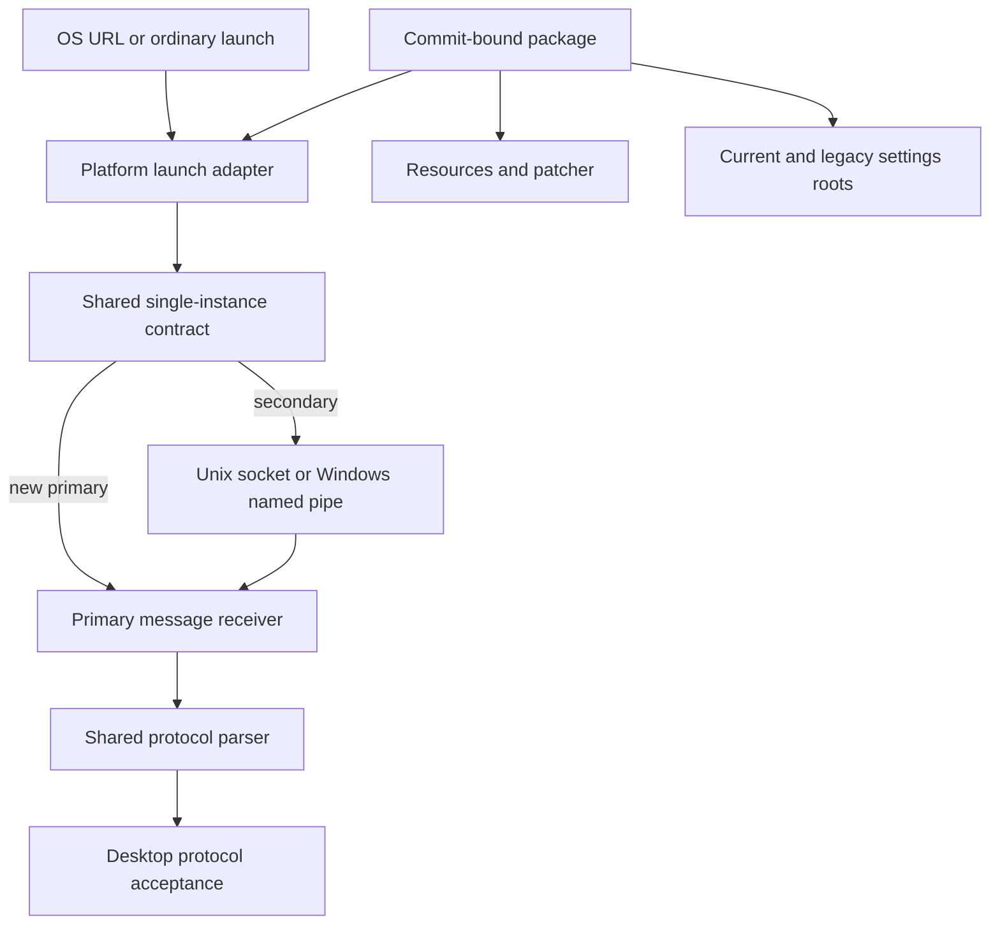

# Platform Protocol and Packaging Parity - Plan

This plan advances F23 and F28 from their current partial state. It does not close either domain until commit-bound installed artifacts pass the native acceptance matrix required by `docs/parity/ACCEPTANCE.md:58-64`.

## Goal Capsule

- **Objective:** A reviewer can install a commit-bound ModSync pre-release artifact, open `nxm://` and `modsync://` links into the correct cold or running desktop instance, retain compatible settings, and reject a missing or incompatible packaged patcher before game mutation (`docs/parity/ACCEPTANCE.md:58-64`, `src/engine.rs:1565-1574`). Mid-execution patcher failure and rollback remain governed by the engine/recovery parity slices (`src/engine.rs:799-838`).
- **Means:** Complete the shared protocol/registration/single-instance contracts first, add thin platform launch adapters second, then package and verify the release executables through Linux-host and native-target receipts (KTD1-KTD9).
- **Authority:** The pinned C# source at `d31ccbd3bfcddb4705917eafa6483715c166de3b` is the behavioral oracle; the active ledger preserves the full C# parity objective and its proof boundary (`docs/parity/ACCEPTANCE.md:28-32`, `docs/parity/ACCEPTANCE.md:58-64`).
- **Execution profile:** Production source, packaging metadata, workflows, and direct CLI/native probes only; no Rust tests or harnesses may be created, changed, or run before full parity (`docs/parity/ACCEPTANCE.md:20-28`).
- **Stop conditions:** Stop a platform lane when it would mutate a real user registration/settings tree, use an unbound artifact, publish a release, or substitute static inspection for native delivery (`docs/parity/ACCEPTANCE.md:58-64`).
- **Acceptance owner:** One final reviewer who did not implement a lane reconciles artifact hashes, native receipts, compatibility claims, and F23/F28 ledger status before delivery (`docs/parity/download-orchestration-plan.md:427-453`).

---

## Product Contract

### Summary

Complete the platform edge around the existing shared parser/fetch/resolver: reliable first/second-instance delivery, truthful register/status/unregister behavior, installable platform packages, packaged resource and patcher availability, compatible settings migration, and manual commit-bound release artifacts (`src/protocol.rs:47-213`, `src/protocol_registration.rs:1-78`, `src/single_instance.rs:24-84`, `docs/parity/ACCEPTANCE.md:58-64`).

### Problem Frame

Rust already handles most protocol semantics, but platform integration stops at a Unix socket, generated Windows commands, macOS plist fragments, and a Linux-only registration command (`src/protocol.rs:47-213`, `src/single_instance.rs:24-84`, `src/protocol_registration.rs:1-78`, `src/main.rs:618-631`). The release surface is thinner still: current CI tests three OSes but emits no installable artifact, while runtime patcher lookup assumes a package-owned `Resources` layout that no Rust packaging workflow creates (`.github/workflows/ci.yml:1-22`, `src/patcher.rs:59-80`).

### Requirements

**Protocol delivery and registration**

- R1. Every supported package accepts `nxm://` and `modsync://` through one shared parser and routes cold-start and warm-instance URLs into the same GUI acceptance path (`src/protocol.rs:47-60`, `src/ui.rs:1788-1821`, `src/ui.rs:3171-3204`).
- R2. A second ordinary launch activates the primary, while a second protocol launch forwards exactly one bounded request and exits only after the primary acknowledges its request ID, validation, and queueing. The primary deduplicates retried request IDs. Stale endpoints may be reclaimed only after a refused/missing result, a second live-owner probe, and serialized takeover (`src/single_instance.rs:40-75`, `C# src/ModSync.GUI/Services/SingleInstanceService.cs:70-139`, `C# src/ModSync.GUI/Services/SingleInstanceService.cs:244-268`).
- R3. Windows uses a per-user, local-only named pipe rather than the current non-Unix stub, with the same activation/URL message semantics and 8192-byte admission bound as Unix. Both transports authenticate the current OS user, bound clients, queue depth, and all I/O/acknowledgement deadlines (`src/single_instance.rs:53-65`, `src/single_instance.rs:78-84`).
- R4. Registration exposes register, status, and compare-and-delete unregister for both schemes, reports external-tool failures, never requires elevation, and never silently replaces a handler without an explicit user action. Ownership binds a package/channel token plus the canonical current executable, so an old uninstaller cannot remove a newer or different-channel handler (`src/protocol_registration.rs:11-77`, `C# src/ModSync.GUI/Services/NxmProtocolRegistrationService.cs:95-237`).
- R5. A registered Windows open command enters `gui --protocol`; it must not enter the current positional parse-and-print branch (`src/protocol_registration.rs:31-36`, `src/main.rs:403-432`).
- R6. A macOS `.app` declares both URL schemes in one `CFBundleURLTypes` value and delivers AppKit open-URL events into the shared GUI protocol channel (`src/protocol_registration.rs:40-46`, `C# src/ModSync.GUI/Info.plist:21-31`, `Cargo.lock:6490-6491`).

**Packaging and platform launch**

- R7. Release artifacts exist for every target retained by the matrix decision in KTD5, carry platform identity/icons/launch metadata, and are reproducibly bound to one source commit and lockfile; an unsupported C# target remains an explicit parity exception rather than disappearing from the matrix (`Cargo.toml:1-12`, `C# .github/workflows/build-and-release.yml:78-130`).
- R8. Linux ships a versioned archive with per-user install/uninstall scripts for its launcher and MIME associations; macOS ships a zipped `.app`; Windows ships a versioned ZIP with a GUI-subsystem launcher for registered links and a console-subsystem CLI companion. Registration targets the GUI launcher (`src/protocol_registration.rs:11-77`, `C# src/ModSync.GUI/ModSync.csproj:34-60`, `C# .github/workflows/build-and-release.yml:282-364`).
- R9. Every artifact manifest states whether a supported patcher is bundled, records its hash/license/source, and places it at a platform-correct runtime location or marks patching unavailable before install; macOS must not assume `Contents/MacOS/Resources` is the bundle resource directory (`src/patcher.rs:8-80`, `C# scripts/ci/bundle-macos-app.ps1:37-60`, `src/engine.rs:1565-1574`).
- R10. An artifact that declares patching available authenticates its patcher input against version-controlled provenance, prefers the package-owned binary over `PATH`, verifies the selected digest immediately before execution, accepts the existing Rust argv, and completes a disposable native patch probe before F28 acceptance (`src/patcher.rs:8-80`, `src/engine.rs:1700-1714`).

**Settings and release safety**

- R11. Default settings resolve to the platform config directory under `ModSync`; if current settings are absent, a legacy `KOTORModSync/settings.json` is read and written forward without losing unrelated fields or exposing secrets (`src/profiles.rs:12-20`, `src/profiles.rs:275-323`).
- R12. An explicit settings root is authoritative and never consults the process user's global legacy root. Migration is idempotent, does not overwrite an existing current file with legacy data, preserves case-insensitive known fields, rejects symlink/reparse-point and wrong-owner paths, maintains current-user-only permissions/ACLs across atomic replacement, and handles malformed desktop versus CLI settings without corrupting either source (`src/profiles.rs:122-139`, `src/profiles.rs:275-323`, `C# src/ModSync.GUI/Models/AppSettings.cs:266-360`).
- R13. Release construction and artifact retention are automated, but public publication remains a separate manual opt-in action outside this plan unless the user explicitly requests it (`C# docs/manual-release.md:28-45`, `docs/parity/ACCEPTANCE.md:63-64`).
- R14. Every acceptance receipt distinguishes Linux-native behavior, Linux-side cross-artifact inspection, and native Windows/macOS behavior (`docs/parity/ACCEPTANCE.md:58-64`).

### Acceptance Examples

- AE1. **Cold protocol launch.** Covers R1, R4-R8. Given no running instance and an installed handler, opening each scheme starts the packaged desktop once and reaches the correct pending protocol state; malformed input fails visibly without fetching (`src/main.rs:417-432`, `src/ui.rs:1788-1821`).
- AE2. **Warm protocol launch.** Covers R1-R3. On Linux and Windows, a live primary causes a short-lived secondary to forward one identified request, receive the matching acknowledgement, and exit; the primary handles URLs in arrival order and deduplicates a retry after a lost acknowledgement. On macOS, Launch Services delivers the warm URL through the application event callback without requiring a second process (`src/single_instance.rs:40-76`, `src/ui.rs:2848-2858`).
- AE3. **Ordinary second launch.** Covers R2-R3. Given a live primary and no URL, a secondary forwards `__MODSYNC_ACTIVATE__`, exits, and does not enqueue a protocol (`src/single_instance.rs:4-4`, `src/single_instance.rs:43-65`).
- AE4. **Stale endpoint.** Covers R2-R3. Given a stale socket or pipe and no live primary, the next launch reclaims the endpoint only after a refused/missing result, a second owner probe, and lock-serialized takeover; permission, timeout, resource, and write failures never trigger unlink/takeover (`src/single_instance.rs:40-50`, `C# src/ModSync.GUI/Services/SingleInstanceService.cs:83-105`).
- AE5. **Handler ownership.** Covers R4-R6. Given another application or another ModSync package/channel owns `nxm`, status reports that exact class; registration changes it only after the explicit command; unregister compare-and-deletes only the same package/channel and canonical command. An A-register, B-upgrade, A-uninstall sequence preserves B's handler (`C# src/ModSync.GUI/Services/NxmProtocolRegistrationService.cs:157-221`).
- AE6. **Legacy settings.** Covers R11-R12. Given only legacy settings with known, unknown, and secret fields, the packaged app loads them, one preference save writes current settings atomically, and a second launch reads the current file without rewriting the legacy file (`src/profiles.rs:275-323`).
- AE6a. **Explicit settings isolation.** Covers R12. Given a global legacy file and an empty explicit settings root, the packaged command reads neither global data nor secrets; malformed desktop and CLI files follow their separately declared policies without overwriting the input (`src/profiles.rs:122-139`, `src/profiles.rs:275-307`).
- AE7. **Patcher present.** Covers R9-R10. Given the package-bundled backend and a disposable patch fixture, default lookup finds the packaged file and the native invocation produces the expected output and clean log (`src/patcher.rs:68-80`, `src/engine.rs:1685-1714`).
- AE8. **Patcher absent or wrong architecture.** Covers R9-R10. Given no compatible backend, validation/install reports unavailable patching before live writes rather than claiming the package is complete (`src/engine.rs:1565-1574`).
- AE9. **Release binding.** Covers R7-R10, R13-R14. Given a workflow artifact, its receipt binds source commit, lockfile, executable and resource hashes, package manifest, native probe platform, and publication state (`docs/parity/ACCEPTANCE.md:63-64`).
- AE10. **Distribution trust boundary.** Covers R7-R8, R13-R14. Unsigned/unnotarized output is labeled a pre-release artifact and cannot be called an end-user-supported package; promotion requires a later signed/notarized installed-artifact receipt where the platform enforces those controls (`C# docs/manual-release.md:9-45`).

### Success Criteria

- F23 may move from partial only when both schemes pass cold/warm delivery and ownership/status probes on Linux, Windows, and macOS, including a real Windows named pipe (`docs/parity/ACCEPTANCE.md:58-58`).
- F28 may move from partial only when installed artifacts on each supported target prove launcher identity, resources, patcher capability, settings migration, and commit binding (`docs/parity/ACCEPTANCE.md:63-64`).
- A Linux-built or downloaded foreign artifact may satisfy static composition rows only; native delivery rows remain open until a native machine produces them (`docs/parity/ACCEPTANCE.md:58-64`).
- No release is published, unsigned/unnotarized output is not called end-user-supported, and no user-owned registration/settings tree is used by acceptance (`C# docs/manual-release.md:28-45`, `src/profiles.rs:12-20`).

### Scope Boundaries

In scope: F23's remaining OS registration and single-instance delivery plus F28's package/resource/patcher/settings/release-artifact chain (`docs/parity/ACCEPTANCE.md:58-64`).

Deferred to their owning slices: acquisition orchestration, Nexus authentication policy, profile behavior beyond migration, general UI/settings design, and patch-byte equivalence beyond the packaged-backend smoke contract (`docs/parity/download-orchestration-plan.md:355-469`, `docs/parity/ACCEPTANCE.md:48-58`).

Outside this plan: Rust test changes, public release publication, signing/notarization credentials, auto-update/appcast work, package-manager repositories, and changing installer behavior in `src/engine.rs` (`docs/parity/ACCEPTANCE.md:20-28`, `C# docs/manual-release.md:28-45`, `src/engine.rs:786-838`).

---

## Planning Contract

### Binding constraints

- Preserve the dirty, user-owned `AGENTS.md` and every unrelated agent lane. Source work waits for the current owners of `src/ui.rs`, `src/main.rs`, `src/profiles.rs`, and the acquisition/p2p/merge/telemetry/markdown/deployment/selection/recovery modules to release their files; the current serialized ownership convention forbids unreported expansion (`docs/parity/download-orchestration-plan.md:355-368`).
- Keep parsing, registration decisions, and single-instance transport in shared library modules. `src/main.rs` and `src/ui.rs` are adapters; they may select commands, hold a receiver, activate a window, and render status, but they must not reimplement URL parsing or ownership rules (`src/lib.rs:33-36`, `src/main.rs:585-631`, `src/ui.rs:1788-1821`).
- Keep desktop and CLI installation behavior in `src/engine.rs`; this plan does not modify it (`src/engine.rs:786-838`).
- Registration and migration probes use disposable per-user roots. Validation must not launch external patchers; only the explicitly authorized native package probe runs the packaged patcher against disposable trees (`src/engine.rs:1550-1574`, `docs/parity/ACCEPTANCE.md:20-28`).
- Guide order, recovery, and install failure rules remain unchanged (`src/engine.rs:799-838`).
- Do not build during planning. Implementation-time builds use the host runner, an owned target directory, and `-j 2`; CI/native jobs retain their own isolated outputs (`.github/workflows/ci.yml:18-22`).

### Key Technical Decisions

- KTD1. **One protocol authority.** `src/protocol.rs` remains the only parser and typed link authority; OS adapters forward opaque strings and validate through it at the receiving edge (R1-R3) (`src/protocol.rs:13-60`, `src/ui.rs:1788-1821`).
- KTD2. **One authenticated, acknowledged transport contract.** Keep the public primary-or-forward result, add a target-specific Windows named-pipe backend, and namespace endpoints by OS user plus stable package channel. Unix uses an owner-only runtime directory/socket and peer-credential checks; Windows uses a local pipe restricted to the current logon SID/session. Both transports use identified requests, finite connection/read/enqueue/acknowledgement deadlines, bounded clients and queue depth, acknowledgement after successful enqueue, and recent-ID deduplication. Unix takeover discriminates error kinds and uses a lock-serialized second probe (R2-R3) (`src/single_instance.rs:40-84`).
- KTD3. **Registration is a shared stateful API.** Extend `src/protocol_registration.rs` with platform-dispatched register/status/compare-and-delete unregister operations for both schemes. Status distinguishes this canonical package/channel, another ModSync install, another application, a missing target, and failure. Command rendering stays pure; process/registry results are returned rather than discarded (R4-R6) (`src/protocol_registration.rs:11-77`).
- KTD4. **Every OS protocol launch enters the shared GUI protocol path.** Windows and Linux registration use an explicit GUI subcommand; macOS application URL callbacks feed the same receiver without depending on argv or a second process (R1, R5-R6) (`src/main.rs:30-45`, `src/ui.rs:2848-2858`, `src/ui.rs:3171-3204`).
- KTD5. **The target matrix is fail-closed and explicit.** Start from every C# architecture/OS-version lane and record each as retained or as a named parity exception with patcher and native-proof status. A target without a reviewed patcher may emit a clearly limited artifact for F23/other capabilities, but its manifest declares patching unavailable and it cannot close F28. Packaging fails when an artifact claims a patcher that is missing, unauthenticated, or wrong-architecture (R7-R10) (`C# .github/workflows/build-and-release.yml:78-130`, `src/patcher.rs:31-80`).
- KTD6. **Package and resolver share one trusted platform layout.** Packaging and `src/patcher.rs` change in the same unit. macOS resolves conventional `Contents/Resources`; packaged launches prefer the manifest-bound package binary over `PATH`; an explicitly configured external patcher remains a separate user trust decision and never satisfies packaged capability. Never silently fall back to Wine (R9-R10) (`src/patcher.rs:8-80`, `C# scripts/ci/bundle-macos-app.ps1:37-60`).
- KTD7. **Copy-forward settings migration.** The legacy file remains untouched; the first successful preference mutation atomically creates current settings with preserved unrelated fields, and an existing current file always wins (R11-R12) (`src/profiles.rs:275-323`).
- KTD8. **Artifacts before publication.** A manual workflow builds and retains packages by default; publication requires a separate explicit boolean and is not enabled or exercised by this plan (R13-R14) (`C# .github/workflows/build-and-release.yml:1-19`, `C# docs/manual-release.md:28-45`).
- KTD9. **Concrete distribution vehicles.** Windows uses a versioned ZIP containing separate GUI-launcher and console-CLI executables; Linux uses a versioned archive with reversible per-user XDG install/uninstall scripts; macOS uses a zipped `.app`. These are pre-release vehicles until later platform signing/notarization receipts permit an end-user-supported claim (R7-R8, R13-R14) (`C# .github/workflows/build-and-release.yml:282-364`, `C# docs/manual-release.md:9-45`).

### Shared library API versus presentation

Shared library facts and actions:

- typed `Link` parsing and protocol rejection (`src/protocol.rs:13-60`)
- instruction fetch safety and component resolution (`src/protocol.rs:62-213`)
- single-instance outcome: primary receiver/guard or forwarded-and-exit (`src/single_instance.rs:24-84`)
- bounded activation/URL message classification (`src/single_instance.rs:4-4`, `src/single_instance.rs:53-65`)
- registration state per scheme: unsupported, absent, owned by this package/channel, owned by another ModSync install, owned by another application, missing target, failed (`src/protocol_registration.rs:1-78`, `C# src/ModSync.GUI/Services/NxmProtocolRegistrationService.cs:194-221`)
- platform settings roots and atomic settings writes (`src/profiles.rs:12-20`, `src/profiles.rs:275-323`)
- patcher capability carries an explicit trust class: package-owned and manifest-bound, explicitly user-configured external, `PATH` fallback, or unavailable (`src/patcher.rs:8-80`)

Presentation and adapter state:

- CLI subcommand spelling, text/JSON formatting, and exit codes remain in `src/main.rs` (`src/main.rs:12-24`, `src/main.rs:585-631`).
- GUI checkboxes, ownership labels, confirmation copy, activation/focus, and the retained pending URL remain in `src/ui.rs` after its current owner releases it (`src/ui.rs:1755-1821`, `src/ui.rs:2848-2858`).
- Package file layout, icon metadata, archive naming, and CI retention live outside the engine and protocol domain (`Cargo.toml:1-12`, `.github/workflows/ci.yml:1-22`).

### High-Level Technical Design

The package owns launch identity and resources; the shared library owns protocol, transport outcome, registration state, settings path rules, and patcher discovery; the GUI owns user-visible confirmation and window activation (`src/lib.rs:33-36`, `src/ui.rs:1755-1821`, `src/patcher.rs:8-80`).

### Sequencing and ownership

File ownership is serialized; independent lanes may proceed in parallel when their owned paths do not overlap. Manifest changes are staged by one owner even when the transport and registration source lanes run concurrently (`Cargo.toml:1-48`, `.github/workflows/ci.yml:1-22`).

| Task | Owned files | Starts when | Responsibility |
|---|---|---|---|
| U1 | `src/single_instance.rs`, `Cargo.toml`, `Cargo.lock` | Current manifest owners are clear | Windows named-pipe backend plus the shared Unix/Windows authenticated acknowledgement protocol; preserve Unix endpoint and user-visible semantics |
| U2 | `src/protocol_registration.rs`, staged `Cargo.toml`/`Cargo.lock` changes | Registration source can start with U1; one manifest owner lands dependencies | Register/status/compare-and-delete unregister and correct commands for both schemes |
| U3 | `src/main.rs`, `src/ui.rs`, optional new `src/platform_macos.rs` | Current `main.rs`/`ui.rs` owners explicitly release both files; U1-U2 approved | CLI/GUI adapters, activation, AppKit URL channel, truthful status UI |
| U4 | `packaging/**` (new), `assets/**`, `src/patcher.rs`, `build.rs` if required, `Cargo.toml`, `Cargo.lock` | U3 source interface and target/vehicle matrix frozen | Linux vehicle, Windows executables/resources, macOS bundle, manifests, trusted patcher layout/lookup |
| U5 | `src/profiles.rs`, coordinated `src/main.rs`/`src/ui.rs` settings call sites | Current settings/main/UI owners jointly release the paths; may proceed independently of U4 | Preserve default-versus-explicit root provenance, migration compatibility, owner-only storage |
| U6 | new manual artifact workflow, release runbook, packaging scripts | Workflow scaffolding may start after KTD5/KTD9; artifact execution waits for U1-U5 | Cross/native artifact jobs, inspection, retention, no default publication |
| U7 | `docs/parity/platform-protocol-packaging-native/**`, `COMPATIBILITY.md`, `docs/parity/ACCEPTANCE.md` | Exact artifacts downloaded and hashed | Direct/native receipts and honest F23/F28 status |

Workers must not edit outside their row without reporting the exact expansion. A task that encounters conflicting changes from another lane stops and rebases after that owner delivers; it never overwrites the other lane (`docs/parity/download-orchestration-plan.md:355-368`).

### Risks and dependencies

- **macOS event timing:** AppKit may deliver a URL before the egui application state exists. The platform adapter must queue it and drain through the same receiver after initialization (`src/ui.rs:3171-3204`, `C# src/ModSync.GUI/Services/ModSyncHandoffQueue.cs:10-23`).
- **handler ownership:** Registration can displace another mod manager. Status and explicit confirmation must precede replacement, and unregister must avoid deleting a non-ModSync owner (`C# src/ModSync.GUI/Services/NxmProtocolRegistrationService.cs:194-221`).
- **stale transport races:** Reclaiming a pipe/socket too early can create two primaries. Only a refused/missing result followed by a second owner probe under the takeover lock permits reclamation (`src/single_instance.rs:40-50`, `C# src/ModSync.GUI/Services/SingleInstanceService.cs:83-105`).
- **foreign artifact proof inflation:** PE/plist/archive inspection is static evidence only; native delivery remains a separate gate (`docs/parity/ACCEPTANCE.md:58-64`).
- **patcher licensing and architecture:** No backend may be bundled until source, license, target architecture, and invocation are recorded in the manifest (`src/patcher.rs:31-80`, `src/engine.rs:1700-1714`).
- **settings secrets:** Migration receipts hash/redact secret values and never print settings contents; preference code reads the Nexus key from the same object (`src/profiles.rs:306-323`).

### Open questions with defaults

1. **Windows pipe dependency.** Default: a Windows-target-only maintained local-IPC crate with bounded byte messages. Preserve Unix endpoint identity and activation/URL semantics while upgrading its wire protocol with the shared request-ID, acknowledgement, deadline, authentication, and deduplication contract (`src/single_instance.rs:6-84`).
   **Delivery rule:** a secondary exits successfully only after the primary acknowledges message validation and enqueue; timeouts and channel closure are failures, not successful forwarding (`src/single_instance.rs:53-75`).
2. **Registration policy.** Default: `modsync` registration is offered explicitly and `nxm` replacement requires explicit confirmation because another manager may own it (`C# src/ModSync.GUI/Services/NxmProtocolRegistrationService.cs:194-221`).
3. **macOS handler mechanism.** Default: one app delegate receives both schemes and feeds a bounded channel; do not depend on URLs becoming argv because the current GUI API only accepts an explicit `protocol` argument (`src/ui.rs:3171-3204`, `Cargo.lock:6490-6491`).
4. **Packaged patcher.** Default: OdyPatcher when a reviewed native artifact and license exist for the target; otherwise the package declares patching unavailable and F28 remains open (`src/patcher.rs:36-43`, `src/engine.rs:1711-1713`).
5. **Release architecture matrix.** Default: track Windows i686/x86_64/aarch64, Linux x86_64/aarch64, and macOS x86_64/aarch64, while retaining the C# `win7-*` lanes as separate unresolved OS-version compatibility rows. A target or OS-version row may be removed only by a recorded support decision and remains an F28 parity exception until then (`C# .github/workflows/build-and-release.yml:87-129`, `docs/parity/ACCEPTANCE.md:63-64`).
6. **Signing/notarization.** Default: record unsigned/unnotarized status and required native manual steps; do not introduce or request secrets in this slice (`C# docs/manual-release.md:9-12`).
7. **Malformed settings.** Default: match the C# GUI by loading desktop defaults without overwriting the malformed input, while explicit CLI settings operations remain fail-closed and report the parse error; both branches require direct packaged probes (`C# src/ModSync.GUI/Models/AppSettings.cs:266-313`, `src/profiles.rs:278-307`).
8. **Version authority.** Default: keep `Cargo.toml` as the Rust version source and require the archive name, embedded platform metadata, CLI output, manifest, and release tag to match it; adopting the C# `2.0.0a1` lineage is a separate product decision (`Cargo.toml:1-7`, `C# src/ModSync.GUI/Info.plist:5-18`).
9. **Windows version floor.** Default: record the C# `win7-*` lanes as explicit unresolved compatibility rows rather than treating them as architecture duplicates; tier-1 Rust Windows artifacts do not close those rows until the supported Windows-version floor is decided and natively proven (`C# .github/workflows/build-and-release.yml:87-129`, `docs/parity/ACCEPTANCE.md:63-64`).

---

## Implementation Units

### U1. Windows named-pipe single-instance transport

- **Goal:** Replace the non-Unix stub and upgrade Unix and Windows to one authenticated acknowledgement contract while preserving the Unix endpoint and user-visible activation/URL semantics.
- **Requirements:** R2-R3; AE2-AE4.
- **Dependencies:** None; manifest ownership must be clear.
- **Files:** `src/single_instance.rs`, `Cargo.toml`, `Cargo.lock`. Existing frozen test code in `src/single_instance.rs:87-115` is preserved byte-for-byte.
- **Approach:** Add a target-specific backend behind the current `claim_or_forward` outcome. Apply current-user authentication, package-channel namespacing, request IDs, one-message framing, 8192-byte bound, finite deadlines, bounded clients/queue, acknowledged enqueue, retry deduplication, discriminated failures, and lock-serialized stale takeover (KTD2) (`src/single_instance.rs:24-84`).
- **Execution note:** Characterize with production binary pairs and OS inspection tools; do not add or run Rust tests (`docs/parity/ACCEPTANCE.md:20-28`).
- **Direct scenarios:** first primary, second activation, second `nxm`, second `modsync`, lost acknowledgement/retry, slow partial write, never-closing client, queue/client saturation, oversize/empty payload, stale endpoint, concurrent cold starts, primary exit/restart, different OS users, stable/beta side-by-side installs.
- **Verification:** Windows receipts show one primary, one short-lived secondary per launch, ordered delivery, bounded rejection, and no duplicate primary.

### U2. Stateful cross-platform registration

- **Goal:** Make both schemes registerable, queryable, and removable through one shared API.
- **Requirements:** R4-R6; AE1, AE5.
- **Dependencies:** None for registration source; one manifest owner serializes any dependency changes with U1.
- **Files:** `src/protocol_registration.rs`, `Cargo.toml`, `Cargo.lock`. No Rust test file changes.
- **Approach:** Preserve pure builders, target the Windows GUI launcher with `gui --protocol`, combine macOS declarations, return subprocess/registry failures, and add package/channel-aware status plus compare-and-delete unregister operations (KTD3-KTD4) (`src/protocol_registration.rs:11-77`, `src/main.rs:403-432`).
- **Direct scenarios:** paths with spaces/quotes, missing helper tools, other-app and other-ModSync owners, missing executable target, idempotent register, repeated unregister, A-register/B-upgrade/A-uninstall, bundle vs non-bundle macOS status, isolated Linux XDG registration.
- **Verification:** CLI receipts show truthful before/register/after/unregister state for each scheme without touching the user's real handler state.

### U3. Desktop and CLI platform adapters

- **Goal:** Route cold URLs, forwarded URLs, activation, and registration controls through the shared library without duplicating business rules.
- **Requirements:** R1-R6; AE1-AE5.
- **Dependencies:** U1-U2 and release of current `src/main.rs`/`src/ui.rs` ownership.
- **Files:** `src/main.rs`, `src/ui.rs`, optional new `src/platform_macos.rs`, `src/lib.rs` only if the new adapter must be exported. Existing inline Rust tests remain unchanged.
- **Approach:** Add CLI register/status/unregister adapters; attach the macOS URL callback/channel before GUI state initialization; merge first-launch, AppKit, and secondary messages into `accept_protocol`; use activation only for the sentinel (KTD1, KTD4) (`src/main.rs:585-631`, `src/ui.rs:1788-1821`, `src/ui.rs:2848-2858`, `src/ui.rs:3171-3204`).
- **Direct scenarios:** URL before app creation, URL after idle, two sequential URLs, malformed URL, activation-only, receiver disconnect, stale message after app exit, UI busy during arrival.
- **Verification:** Native transcripts bind each OS entry point to the same parsed payload and GUI outcome.

### U4. Installable package layouts and resources

- **Goal:** Produce real Linux, Windows, and macOS application artifacts from the approved source contract.
- **Requirements:** R7-R10; AE7-AE10.
- **Dependencies:** U3.
- **Files:** `packaging/linux/**` (new), `packaging/windows/**` (new), `packaging/macos/**` (new), `assets/**`, `src/patcher.rs`, `Cargo.toml`, `Cargo.lock`, `build.rs` only if Windows resource compilation requires it. No test files.
- **Approach:** Build the KTD9 vehicles with platform identity, icons, launch metadata, both schemes, docs/licenses, and a manifest of every executable/resource. Change `src/patcher.rs` with the layout, authenticate any declared patcher input, prefer the package copy over `PATH`, and fail when a claimed patcher is absent, unauthenticated, or wrong-architecture. A deliberately patcher-less artifact remains limited and cannot close F28 (KTD5-KTD6, KTD9) (`Cargo.toml:1-48`, `src/patcher.rs:8-80`, `C# scripts/ci/bundle-macos-app.ps1:37-60`).
- **Execution note:** This is packaging/config work; use artifact inspection and installed runtime smoke evidence instead of unit coverage.
- **Direct scenarios:** clean install/uninstall, path containing spaces, read-only install directory, architecture mismatch, missing resource, duplicate/stale package, launcher from file manager and terminal.
- **Verification:** Extracted manifests and installed probes agree on executable/resource hashes, scheme declarations, architecture, launcher identity, and patcher capability.

### U5. Settings migration and storage isolation

- **Goal:** Prove default and explicit settings roots read/write compatible data without crossing ownership or secrecy boundaries.
- **Requirements:** R11-R12; AE6-AE6a.
- **Dependencies:** Release of current `src/profiles.rs`, `src/main.rs`, and `src/ui.rs` ownership; source work may proceed independently of U4.
- **Files:** `src/profiles.rs` plus coordinated settings-root call sites in `src/main.rs`/`src/ui.rs`; package manifests and `src/engine.rs` are read-only for this unit.
- **Approach:** Carry default-versus-explicit root provenance through every `Store` call site so an explicit root cannot consult global legacy data. Keep current-file precedence, legacy preservation, case-insensitive keys, full-object preservation, atomic owner-only writes, symlink/reparse/wrong-owner rejection, and the settled malformed-file policy (KTD7) (`src/profiles.rs:122-139`, `src/profiles.rs:275-323`).
- **Direct scenarios:** current only, legacy only, both, explicit empty root with a global legacy canary, malformed legacy, malformed current, unknown fields, mixed-case known keys, secret redaction, permissive/wrong-owner file, symlink/reparse point, interrupted write.
- **Verification:** Before/after manifests show no global-root read from an explicit store, no legacy mutation or unrelated field loss, owner-only final and temporary files, and no secret bytes in retained receipts.

### U6. Manual artifact workflow

- **Goal:** Build, inspect, retain, and optionally prepare platform packages without publishing by default.
- **Requirements:** R7-R10, R13-R14; AE9-AE10.
- **Dependencies:** Workflow scaffolding begins after KTD5/KTD9; building and accepting artifacts waits for U1-U5.
- **Files:** new `.github/workflows/build-artifacts.yml`, `docs/manual-release.md` (new if the repo still lacks one), packaging scripts under `packaging/**`. Existing `.github/workflows/ci.yml` and all test files remain unchanged unless a later separately reviewed gate cannot live in the artifact workflow.
- **Approach:** Add manual/workflow-call artifact lanes, bind each to `head_sha`, pin third-party workflow actions and patcher inputs to immutable reviewed identities, use least-privilege permissions and native runners where runtime evidence is required, perform Linux-side PE/archive/plist inspection, hash outputs, retain sanitized artifacts, and leave publication disabled unless a future user request adds it (KTD8) (`.github/workflows/ci.yml:1-22`, `C# docs/manual-release.md:28-45`).
- **Direct scenarios:** all lanes succeed, one lane fails without cancelling receipts from others, hash mismatch, missing resource, wrong architecture, rerun at a different commit, artifact download and inspection.
- **Verification:** Exact-run artifacts and receipts identify commit, runner OS/architecture, archive and binary hashes, manifest, probe status, and publication=false.

### U7. Native acceptance and ledger reconciliation

- **Goal:** Produce durable installed-artifact evidence and update claims only to the demonstrated level.
- **Requirements:** R1-R14; AE1-AE10.
- **Dependencies:** U1-U6.
- **Files:** `docs/parity/platform-protocol-packaging-native/**` (new), `COMPATIBILITY.md`, `docs/parity/ACCEPTANCE.md`.
- **Approach:** Run the Verification Contract, preserve raw outputs/screenshots/manifests, separate static from native rows, and keep F23/F28 partial wherever a row lacks native proof (`docs/parity/ACCEPTANCE.md:58-64`).
- **Direct scenarios:** the full Linux, Windows, and macOS matrix below; no test or harness execution.
- **Verification:** One independent whole-package review can trace every compatibility/ledger sentence to an artifact and raw receipt.

---

## Verification Contract

### Static gates permitted on this turn

Planning delivery runs only documentation/static checks: confirm this task changed only `docs/parity/platform-protocol-packaging-audit.md` and `docs/parity/platform-protocol-packaging-plan.md`, run `git diff --check` on them, scan all headings/referents, and verify the pinned Rust/C# SHAs. Cargo, Rust tests, harnesses, and builds remain forbidden (`docs/parity/ACCEPTANCE.md:20-28`).

### Implementation source gates

After implementation authority and the test freeze lift independently permit them, the repository's ordinary gates remain `cargo fmt --all -- --check`, `cargo clippy --all-targets -- -D warnings`, `cargo test --all-targets`, and `cargo test --no-default-features`; this plan does not authorize those test commands while the freeze remains (`.github/workflows/ci.yml:18-22`, `docs/parity/ACCEPTANCE.md:20-28`). Before the freeze lifts, production-only build/probe evidence must be labeled weaker than test-target compilation (`docs/parity/ACCEPTANCE.md:20-28`).

### Linux-host direct probes without Rust tests

All receipts live under `docs/parity/platform-protocol-packaging-native/<commit>/` and use disposable owner-only roots. Retained receipts record executable/archive SHA-256, source commit, lockfile hash, redacted argv, exit, stdout/stderr hashes, file manifests, process IDs, and the statement that no Rust tests/harnesses were created, changed, or run. Raw URLs, query credentials, settings secrets, usernames, environment values, and sensitive screenshots stay only in ephemeral owner-only storage and are deleted after sanitized receipts are derived; a canary scan proves they are absent from retained artifacts (`docs/parity/install-progress-plan.md:202-246`, `src/protocol.rs:249-258`, `src/profiles.rs:306-323`).

1. **Linux registration:** isolate `XDG_DATA_HOME`, `XDG_CONFIG_HOME`, and `XDG_RUNTIME_DIR`; register/status/open/unregister both schemes; query `xdg-mime`; verify the desktop Exec enters `gui --protocol`; confirm the real user directories and socket are unchanged (`src/protocol_registration.rs:48-77`, `src/single_instance.rs:33-36`).
2. **Linux cold/warm delivery:** open `nxm`, `modsync`, and ordinary second launches; record primary/secondary process trees, arrival order, activation, malformed/oversize rejection, stale socket recovery, and cleanup (`src/single_instance.rs:24-76`, `src/ui.rs:2848-2858`).
3. **Settings migration:** copy fixtures into disposable current/legacy roots; place a sentinel secret in the process-wide legacy root; launch the packaged CLI/GUI with and without an explicit root; mutate one preference through a production command; compare redacted semantic JSON plus byte/file manifests and prove the explicit run never read the global sentinel (`src/profiles.rs:122-139`, `src/profiles.rs:275-323`).
4. **Linux package:** install/extract the artifact in a disposable prefix; inspect launcher/icon/docs/licenses/resources; run the packaged patcher against disposable mod/game trees; uninstall and compare host manifests (`src/patcher.rs:59-80`, `src/engine.rs:1700-1714`).
5. **Windows static artifact:** download the exact U6 Windows artifact by hash, then inspect both PE roles, machine/subsystem/resources/imports, archive layout, registration command rendering, patcher architecture, and hashes. A separate Linux cross-build may diagnose target compilation but is not the accepted artifact (`src/protocol_registration.rs:11-37`, `src/single_instance.rs:78-84`).
6. **macOS static artifact:** download the exact native-CI artifact and inspect archive/bundle layout, plist validity, both schemes, architectures, icon, executable bits, patcher/resources, and hashes. Mark Launch Services behavior not proven (`src/protocol_registration.rs:40-46`).

Every platform artifact manifest, archive metadata, and release runbook labels unsigned/unnotarized output as pre-release. The final review rejects any end-user-supported claim until a later receipt proves the platform-enforced signing/notarization policy for that vehicle (`C# docs/manual-release.md:9-45`).

### Native Windows matrix

Use a disposable Windows user or ephemeral VM and the exact artifact hash from U6:

- first GUI launch and ordinary activation forwarding
- cold and warm `nxm`/`modsync` shell launches
- named-pipe owner, message bound, order, secondary exit, stale pipe, concurrent cold start
- HKCU register/status/unregister for both schemes, including prior other-app ownership and executable path with spaces
- x64 artifact and each additional claimed architecture
- current/legacy settings migration with ACL and secret-redacted receipt
- packaged patcher availability and disposable execution
- install/uninstall residue and real launcher/icon/version inspection
- GUI handler launch plus console CLI stdout/stderr/exit behavior from both PowerShell and `cmd.exe`

These rows close Windows only; Linux cross-inspection cannot replace them (`src/single_instance.rs:78-84`, `docs/parity/ACCEPTANCE.md:58-64`).

### Native Linux matrix

Run the installed-artifact registration, cold/warm delivery, activation, settings migration/isolation, launcher/resource, packaged-patcher, and install/uninstall probes on every retained Linux architecture. The default matrix therefore requires separate x86_64 and aarch64 native receipts; a cross-built or emulated artifact remains static evidence unless the acceptance ledger explicitly records the weaker boundary (`docs/parity/ACCEPTANCE.md:58-64`, `src/protocol_registration.rs:48-77`, `src/patcher.rs:50-80`).

### Native macOS matrix

Use a disposable macOS account or VM and the exact `.app` hash from U6:

- `plutil`/bundle architecture/resources and both URL declarations
- Launch Services registration after install, cold URL launch, warm URL delivery, arrival before/after UI initialization
- ordinary second launch activation and no duplicate primary
- x64 and arm64 artifacts on matching hardware/runners
- current/legacy settings migration and permissions
- packaged patcher availability and disposable execution
- quarantine, code-signing/notarization status recorded without claiming more than observed
- removal/reinstall and stale registration behavior

These rows close macOS only; plist inspection cannot replace them (`src/protocol_registration.rs:40-46`, `docs/parity/ACCEPTANCE.md:58-64`).

### Review gates

- **U1 specification review:** current-user access controls, package-channel identity, request ID/deduplication, first/second result, activation sentinel, both schemes, 8192-byte bound, one message per connection, finite deadlines, bounded clients/queue, validation/enqueue acknowledgement, error-class discrimination, second owner probe, serialized stale recovery, guard lifetime (`src/single_instance.rs:24-84`).
- **U2-U3 specification review:** one parser, GUI command correctness, both schemes, ownership-aware state, explicit replacement, error propagation, cold/warm delivery, early macOS queue, no adapter fetching (`src/protocol.rs:47-60`, `src/protocol_registration.rs:11-77`, `src/ui.rs:1755-1821`).
- **U4-U5 specification review:** vehicle/executable identity, manifest completeness, platform-correct resource paths, authenticated patcher provenance/architecture/argv, package-before-PATH resolution, explicit-root provenance/isolation, current-over-legacy precedence, malformed settings, unrelated-field preservation, owner-only atomic writes, symlink/reparse rejection, secret redaction (`src/patcher.rs:8-80`, `src/profiles.rs:122-139`, `src/profiles.rs:275-323`).
- **U6 workflow review:** exact commit binding, native runner identity, independent lanes, retained raw receipts, static/native labels, publication off by default (`.github/workflows/ci.yml:1-22`, `C# docs/manual-release.md:28-45`).
- **U7 whole-package review:** a fresh reviewer reads the combined diff and receipts, challenges each F23/F28 claim once with its referent, and leaves any unproved row partial (`docs/parity/ACCEPTANCE.md:58-64`).

---

## Definition of Done

- U1-U7 are implemented in dependency order with serialized ownership for every overlapping file and no unrelated lane overwritten (`docs/parity/download-orchestration-plan.md:355-368`).
- Both schemes share parser, first-launch, forwarded-launch, registration, status, and unregister paths on all supported packages (`src/protocol.rs:47-60`, `src/protocol_registration.rs:1-78`).
- Windows native receipts prove the named pipe and HKCU lifecycle; macOS native receipts prove `.app`/Launch Services cold and warm delivery (`src/single_instance.rs:78-84`, `src/protocol_registration.rs:40-46`).
- Package manifests prove platform identity, icons, launch metadata, licenses/docs, and exact resource/patcher hashes (`Cargo.toml:1-48`, `src/patcher.rs:59-80`).
- Settings receipts prove current precedence, legacy copy-forward, field preservation, atomicity, redaction, and no mutation of user-owned settings (`src/profiles.rs:275-323`).
- Artifact workflow receipts bind every accepted package and native probe to the same commit and lockfile, with publication recorded false unless separately authorized (`C# docs/manual-release.md:28-45`).
- `COMPATIBILITY.md` and `docs/parity/ACCEPTANCE.md` claim only rows supported by raw receipts; F23/F28 remain partial for every missing native target or patcher capability (`docs/parity/ACCEPTANCE.md:58-64`).
- No Rust tests/harnesses were created, changed, or run during the freeze, and abandoned packaging/transport experiments are absent from the final diff (`docs/parity/ACCEPTANCE.md:20-28`).

---

## Appendix

### Source anchors

- Rust protocol core: `src/protocol.rs:13-347`.
- Rust registration: `src/protocol_registration.rs:1-78`.
- Rust single instance: `src/single_instance.rs:1-115`.
- Rust launch adapters: `src/main.rs:30-45`, `src/main.rs:403-432`, `src/main.rs:585-631`, `src/ui.rs:1755-1821`, `src/ui.rs:2848-2858`, `src/ui.rs:3171-3204`.
- Rust settings and patcher: `src/profiles.rs:12-20`, `src/profiles.rs:275-425`, `src/patcher.rs:1-84`, `src/engine.rs:1565-1574`, `src/engine.rs:1700-1714`.
- Rust package/CI baseline: `Cargo.toml:1-48`, `.github/workflows/ci.yml:1-22`.
- C# launch/pipe oracle: `C# src/ModSync.GUI/CLIArguments.cs:37-115`, `C# src/ModSync.GUI/Program.cs:15-101`, `C# src/ModSync.GUI/Services/SingleInstanceService.cs:14-300`.
- C# registration/bundle oracle: `C# src/ModSync.GUI/Services/NxmProtocolRegistrationService.cs:25-350`, `C# src/ModSync.GUI/Services/ModSyncProtocolRegistrationService.cs:19-307`, `C# src/ModSync.GUI/Info.plist:1-33`.
- C# package/release oracle: `C# src/ModSync.GUI/ModSync.csproj:9-340`, `C# .github/workflows/build-and-release.yml:1-374`, `C# docs/manual-release.md:1-53`.
